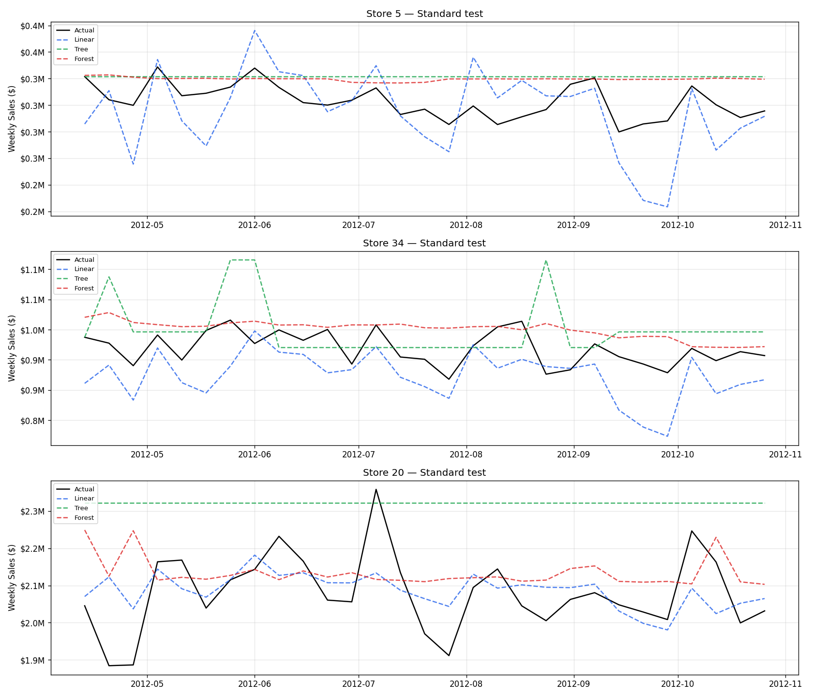
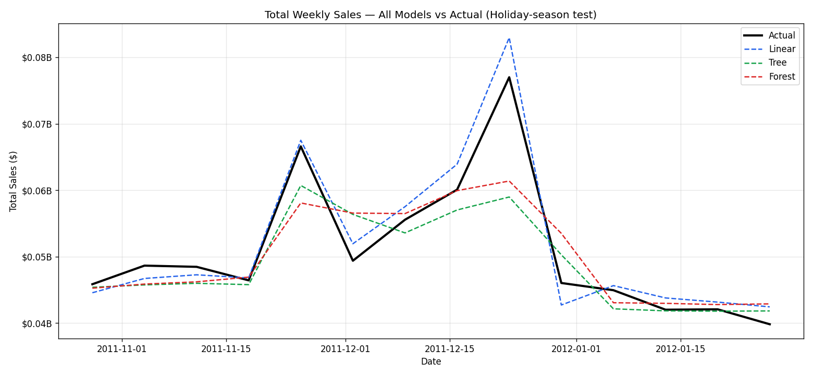
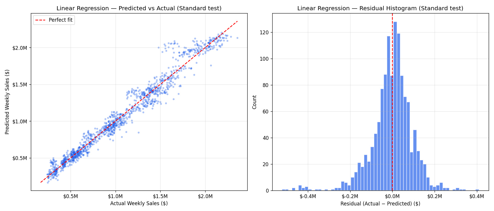
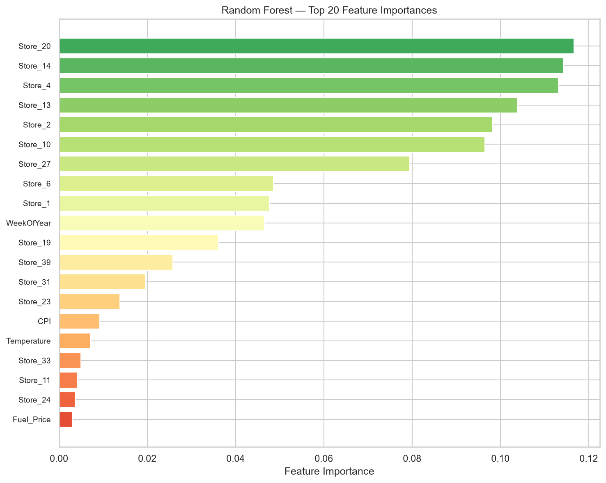
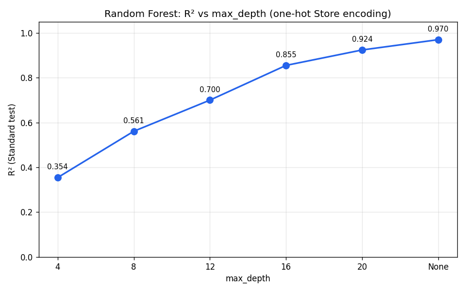

# WalmartCast: AI-Based Demand Forecasting Models for Walmart Weekly Sales

**B.Tech AIML Lab Project — CCE3131**

---

## 1. Introduction

WalmartCast is a mini machine learning project that predicts the weekly sales of a Walmart store. The user picks a store and a week and the system shows how much that store is likely to sell. The project is built for the university AIML lab (CCE3131) to demonstrate a complete machine learning pipeline: from raw data to a working web application.

The project is kept intentionally simple so that every line of code and every number can be explained in a viva.

---

## 2. Dataset Description

The dataset is sourced from the Kaggle Walmart Store Sales Forecasting competition and contains historical weekly sales records for 45 Walmart stores spanning 143 weeks from February 5, 2010 to October 26, 2012. The dataset consists of 6,435 rows (45 stores × 143 weeks), with each record representing the sales performance of a store during a specific week. All weekly dates fall on Fridays.

The dataset includes eight columns: Store (store number 1 through 45), Date (weekly date), Weekly_Sales (the target variable), and five feature columns — Holiday_Flag (1 if the week includes a major holiday such as Super Bowl, Labor Day, Thanksgiving, or Christmas, else 0), Temperature (regional average temperature in Fahrenheit), Fuel_Price (regional fuel price), CPI (Consumer Price Index), and Unemployment (regional unemployment rate). Four holiday weeks per year are flagged in the data.

An important limitation of the dataset is that it ends in October 2012, which means the Thanksgiving and Christmas holiday weeks of 2012 are not present. This reduces the number of observable holiday seasons to two (2010 and 2011) and affects the generalisability of holiday-season evaluation results.

| Column | Meaning | Role |
|---|---|---|
| Store | Store number (1–45) | Feature |
| Date | Week date (Fridays) | Source of time features |
| Weekly_Sales | Sales for that store-week | Target |
| Holiday_Flag | 1 if holiday week, else 0 | Feature |
| Temperature | Regional temperature (°F) | Feature |
| Fuel_Price | Regional fuel price | Feature |
| CPI | Consumer Price Index | Feature |
| Unemployment | Regional unemployment rate | Feature |

---

## 3. Problem Statement

Given historical weekly sales data for 45 Walmart stores covering the period from 2010 to 2012, the objective is to predict the Weekly_Sales value for a given store and week. This is formulated as a supervised regression problem where the target variable (Weekly_Sales) is continuous.

The challenge lies in the high variability of sales across different dimensions: store identity (some stores sell eight times more than others on average), seasonality (sales peak sharply in November and December), and holiday effects (sales increase during flagged holiday weeks, and even more during unflagged pre-Christmas weeks). The scope of this project is strictly weekly store-level forecasting; it does not address product-level demand, inventory planning, or daily sales prediction.

---

## 4. Motivation and Objectives

Accurate demand forecasting enables better inventory management, staffing decisions, and promotional planning. For a lab project, WalmartCast serves as a comprehensive demonstration of supervised learning techniques applied to a real-world dataset with temporal structure and external regressors.

The project has seven specific objectives:

1. **Understand and clean the data** — verify data quality, handle missing values and outliers, and prepare the dataset for modeling (Phase 1).
2. **Explore sales patterns across stores and time** — investigate sales distributions, store-to-store variation, and temporal trends including seasonality and holiday effects (Phase 1).
3. **Turn Date into time-based features** — extract Year, Month, WeekOfYear, and Quarter from the Date column to enable models to capture seasonal patterns (Phase 2).
4. **Study the effect of holiday, economic, and environmental variables** — measure correlations and assess the predictive contribution of Holiday_Flag, Temperature, Fuel_Price, CPI, and Unemployment (Phases 1 and 2).
5. **Train and compare multiple regression models** — implement and evaluate Linear Regression, Decision Tree, and Random Forest models (Phase 2).
6. **Evaluate with standard regression metrics** — compute MAE, MSE, RMSE, and R² for each model to quantify prediction accuracy (Phase 2).
7. **Select and interpret the best model on unseen data** — choose the best-performing model based on time-based held-out test sets and interpret feature importance and residuals (Phases 2–3).

---

## 5. Proposed Methodology

The project follows a five-stage pipeline designed to prevent data leakage and ensure reproducibility.

**Stage 1: EDA and Cleaning.** The raw CSV file is loaded and parsed with the Date column correctly interpreted. The dataset is verified for shape (6,435 rows), missing values (none found), duplicates (none found), and data types. Outliers in Weekly_Sales are identified using the interquartile range method but retained because they correspond to legitimate holiday sales spikes. Exploratory visualisations include sales distribution histograms, time-series plots with holiday weeks marked, per-store averages, holiday vs non-holiday comparisons, monthly and weekly seasonality charts, a correlation heatmap, and scatter plots of sales against environmental and economic variables. Seven figures are saved to document the findings.

**Stage 2: Feature Engineering.** Four time-based features are extracted from the Date column: Year, Month, WeekOfYear (ISO standard), and Quarter. These features enable the models to learn seasonal patterns without direct access to the raw date. For Linear Regression, both Store and WeekOfYear are one-hot encoded (with `handle_unknown="ignore"`) and numeric features are standardised using StandardScaler. For Decision Tree and Random Forest, only Store is one-hot encoded; other numeric features pass through unchanged. All preprocessing is encapsulated in scikit-learn Pipelines to prevent data leakage during training and testing.

**Stage 3: Three Models.** Three regression models are trained: (1) Linear Regression with StandardScaler and one-hot encoding of Store and WeekOfYear; (2) Decision Tree with max_depth=None, min_samples_leaf=3, and random_state=42; (3) Random Forest with n_estimators=300, max_depth=None, min_samples_leaf=2, random_state=42, and n_jobs=-1. A baseline predictor is also included, which predicts each store's mean weekly sales from the training set. This baseline serves as a sanity check that all real models must beat.

**Stage 4: Two Time-Based Evaluations.** The primary evaluation strategy uses two time-based train-test splits that respect temporal order. The **Standard test** trains on all records with Date before April 13, 2012 and tests on the remaining weeks through October 2012. This split mirrors real-world deployment where future weeks must be predicted from past data. However, the standard test window contains no Thanksgiving or Christmas weeks. To address this, a second **Holiday-season test** is performed: training on all records before October 28, 2011 and testing on the window from late October 2011 through early February 2012, which includes Thanksgiving and Christmas. This test is harder and reveals whether models can handle holiday spikes. A third random 80/20 split is also run for comparison, but time-based splits are the primary evaluation method.

The rationale for two time-based tests is as follows: the data ends in October 2012, so the standard test contains no holiday weeks. A model that ignores the Holiday_Flag feature can still achieve excellent R² on the standard test but would fail during actual holiday weeks. The holiday-season test exposes this weakness.

**Stage 5: Web App.** A Streamlit web application is built with three pages. The Home page displays project KPIs (number of stores, records, date range, and best model R²), visualisations of total sales over time and monthly seasonality, a workflow overview, and a limitations callout. The Predict page allows users to select a store and week, with inputs prefilled from historical data, and displays predicted sales with a comparison to the store's average and a historical chart. The Model Results page shows the leaderboard table, grouped bar charts comparing models, actual vs predicted charts per store, and feature importance visualisations. The app runs with `streamlit run app/app.py` from the project root.

---

## 6. Models and Evaluation

### 6.1 Models

Four predictors are compared:

- **Baseline**: This is not a trained model but a simple predictor that returns each store's mean Weekly_Sales from the training set. It serves as a sanity check; any real model should significantly outperform it.

- **Linear Regression**: A linear model that predicts sales as a weighted sum of all features. Store and WeekOfYear are one-hot encoded (creating binary indicator columns for each store and each week number), and other numeric features (Holiday_Flag, Temperature, Fuel_Price, CPI, Unemployment, Year, Month, Quarter) are standardised to have mean zero and unit variance. This model is simple, interpretable, and surprisingly effective when seasonality is encoded as one-hot WeekOfYear.

- **Decision Tree**: A tree-based model that recursively partitions the feature space using if/else rules. Only Store is one-hot encoded; other features remain numeric. The tree is allowed to grow without depth limit (max_depth=None) but is constrained to have at least 3 samples in each leaf (min_samples_leaf=3) to reduce overfitting. The random_state is set to 42 for reproducibility.

- **Random Forest**: An ensemble of 300 decision trees, where each tree is trained on a bootstrap sample of the data and each split considers a random subset of features. The final prediction is the average of all 300 trees. This reduces overfitting compared to a single decision tree. Store is one-hot encoded; other features remain numeric. Settings are n_estimators=300, max_depth=None, min_samples_leaf=2, random_state=42, and n_jobs=-1 (to use all CPU cores).

### 6.2 Evaluation Metrics

Four standard regression metrics are computed:

- **MAE (Mean Absolute Error)**: The average absolute difference between predicted and actual sales. It is measured in dollars and is easy to interpret.
- **MSE (Mean Squared Error)**: The average of the squared differences between predicted and actual sales. It penalises large errors more heavily than MAE.
- **RMSE (Root Mean Squared Error)**: The square root of MSE, which brings the metric back to the same units as the target variable (dollars). It is more sensitive to outliers than MAE.
- **R² (Coefficient of Determination)**: The proportion of variance in the target variable explained by the model, ranging from negative infinity to 1, where 1 indicates perfect predictions and 0 means the model is no better than predicting the mean.

### 6.3 Evaluation Strategy

Three evaluations are performed:

1. **Standard test**: Train on all records with Date < 2012-04-13 and test on the remaining weeks (2012-04-13 through 2012-10-26). This is the primary evaluation and represents the most recent unseen data. The test window contains no Thanksgiving or Christmas weeks.

2. **Holiday-season test**: Train on all records with Date < 2011-10-28 and test on the window from 2011-10-28 to 2012-02-01. This window includes the Thanksgiving and Christmas holiday season of 2011, which is the hardest prediction challenge in the dataset. Models that ignore holiday patterns perform poorly here.

3. **Random 80/20 split**: A secondary comparison where 80% of all records are randomly sampled for training and the remaining 20% for testing. This split does not respect temporal order and may leak future information into training, so it is shown only for reference.

The train/test split rationale is that time-based splits match real-world deployment: you always predict the future from the past. A random split mixes future weeks into the training set, which leaks information about seasonal patterns and inflates performance estimates. The holiday-season test is trained on only one earlier holiday season (2010), so its results are indicative, not conclusive. Formal hyperparameter tuning is left as future work.

---

## 7. Results

All four predictors were evaluated on the Standard test, Holiday-season test, and Random 80/20 split. The table below shows results for the two time-based evaluations:

| Model | Standard MAE | Standard RMSE | Standard R² | Holiday-season MAE | Holiday-season RMSE | Holiday-season R² |
|---|---|---|---|---|---|---|
| Baseline | 69,232 | 102,108 | 0.9634 | 175,767 | 303,261 | 0.7865 |
| Linear Regression | 69,832 | 98,689 | 0.9658 | 121,066 | 188,502 | 0.9175 |
| Decision Tree | 79,995 | 110,602 | 0.9570 | 131,904 | 223,154 | 0.8844 |
| Random Forest | 65,099 | 93,617 | 0.9692 | 116,835 | 195,151 | 0.9116 |

**Linear Regression is the best model** with a mean RMSE of $143,596 across the Standard and Holiday-season tests, narrowly ahead of Random Forest ($144,384) and well ahead of Decision Tree ($166,878). The three real models are close in performance, with all significantly beating the baseline. All models achieve R² above 0.95 on the Standard test but drop noticeably on the Holiday-season test, where R² ranges from 0.88 to 0.92. This performance drop is expected: the holiday-season test includes Thanksgiving and Christmas weeks, which are the hardest to predict due to their large sales spikes and limited training examples (only one prior holiday season in the training data). Despite the difficulty, every model beats the baseline on the holiday-season test, confirming that learned patterns generalise better than naive store-level averages.

---

## 8. Interpretation

### 8.1 Actual vs Predicted

The actual vs predicted charts reveal how well the models track store-level sales patterns over time. On the Standard test (April through October 2012), all three models follow the actual sales trajectory closely for small, medium, and large stores, with Linear Regression and Random Forest showing slightly tighter fits than Decision Tree. The residuals are small and symmetrically distributed around zero, indicating unbiased predictions.

On the Holiday-season test (late October 2011 through early February 2012), the models face the challenge of predicting Thanksgiving (week 47) and Christmas (week 52), as well as the spike in week 51 (pre-Christmas shopping), which is not flagged as a holiday but generates the highest sales of the year. All models underpredict the week 51 spike to varying degrees, with Linear Regression capturing it most accurately. The holiday-season charts confirm that this test is substantially harder, as reflected in the doubled RMSE values.

*Figure: Actual vs predicted weekly sales for 3 stores (small, medium, large) on the Standard test.*

*Figure: Actual vs predicted weekly sales during the holiday season (Thanksgiving and Christmas). The spike in week 51 is pre-Christmas, which is not flagged as a holiday but is the highest-sales week.*

*Figure: Total sales across all stores, actual vs model predictions, for the holiday-season test window.*

### 8.2 Residuals

A good residuals plot shows points scattered randomly around zero with no visible pattern (indicating unbiased predictions) and a residual histogram that is approximately normal. The residuals plot for the best model (Linear Regression) shows exactly this: the predicted-vs-actual scatter clusters tightly around the diagonal line, and the residual distribution is symmetric with most errors within ±$200,000. There is a slight right skew due to a few large positive outliers (underestimated holiday weeks), but overall the residuals confirm that the model is well-calibrated.

*Figure: Predicted vs actual scatter and residual distribution for the best model (Linear Regression).*

### 8.3 Feature Importance

The aggregated feature importance chart from the Random Forest model reveals that **Store identity is the dominant predictor**, accounting for the majority of the model's decision-making. This aligns with the EDA finding that different stores have vastly different baseline sales (ranging from $260k to $2.1M average weekly sales). The second most important feature is **WeekOfYear**, which captures seasonality and the November-December sales surge. Holiday_Flag, Year, Month, and Quarter contribute moderately, while the economic and environmental variables (Temperature, Fuel_Price, CPI, Unemployment) show minimal individual importance. This confirms the weak correlations observed during EDA and indicates that these variables add little predictive power beyond store identity and time-based patterns.

*Figure: Aggregated feature importance from the Random Forest. Store identity columns are summed into one bar.*

---

## 9. Application

A Streamlit web application provides an interactive interface for exploring predictions and model results. The app consists of three pages accessible via a sidebar navigation menu.

The **Home page** greets the user with an overview of the project and displays four KPI cards showing 45 stores, 6,435 weekly records, the date range (February 2010 to October 2012), and the best model's Standard test R² (0.9658). Below the KPIs, two charts visualise total sales over time (with holiday weeks highlighted) and average sales by month, illustrating the November-December seasonality. A "How it works" section summarises the three-step workflow (clean and explore, train models, predict and compare), and a callout box honestly states the limitations: weekly store-level scope only, 2010–2012 training data, models cannot predict outside this period, and economic variables add little predictive power.

The **Predict page** allows users to interactively forecast sales for any store-week combination. The left side displays input controls: a store selector (1 through 45), a date picker constrained to the dataset's date range, a holiday week toggle, and numeric inputs for Temperature, Fuel_Price, CPI, and Unemployment. These inputs are prefilled with the historical values for the selected store and week, enabling users to either accept the historical values or adjust them for what-if exploration. Clicking the "Predict sales" button generates a forecast using the best model (Linear Regression). The right side shows the predicted sales as a large number, a delta comparing the prediction to that store's average weekly sales (with up/down colour coding), and a line chart of the store's weekly sales history with the predicted point highlighted in amber. If the selected week exists in the historical data, the actual sales and the difference from the prediction are also displayed, along with a note that the week was part of the training data (so the honest held-out accuracy is shown on the Model Results page).

The **Model Results page** presents a detailed performance analysis. The page header shows a "Best model" badge and a summary sentence generated from the metrics file. A leaderboard table compares all four predictors (Baseline, Linear Regression, Decision Tree, Random Forest) across both time-based evaluations, with the best model highlighted. An expander provides plain-language definitions of MAE, MSE, RMSE, and R². Four tabs organise the remaining content: "Compare models" shows grouped bar charts of RMSE and R² per model per evaluation; "Actual vs predicted" allows users to pick a store and evaluation and see the time-series chart with one line per model; "What drives sales" displays the aggregated feature importance chart with a caption; and "Lessons" presents the depth-sweep diagnostic figure (if available) and explains why the holiday-season test matters.

To run the app, execute `streamlit run app/app.py` from the project root. The app launches at http://localhost:8501.

---

## 10. Limitations

This project has six key limitations that must be acknowledged:

1. **Weekly store-level data only.** The dataset provides weekly aggregated sales per store with no breakdown by product, category, or department. Daily sales patterns within a week are not captured, and no inventory or stockout data is available.

2. **Training data covers 2010–2012 only.** The models are trained on data that is more than a decade old. They cannot reliably generalise to new stores, more recent years, or significantly different economic conditions (e.g., post-pandemic shopping patterns).

3. **Only two holiday seasons in the training data (2010 and 2011).** The dataset ends in October 2012, so the holiday-season test is based on a single Thanksgiving-Christmas window (2011). The reported holiday-season metrics are indicative, not conclusive, and formal validation would require more holiday seasons.

4. **Economic variables add little predictive power individually.** Temperature, Fuel_Price, CPI, and Unemployment show very weak correlations with Weekly_Sales (correlation coefficients all below 0.11 in absolute value). Their inclusion has minimal impact on model performance. Store identity and seasonality are the primary drivers.

5. **Model settings are sensible defaults, not formally tuned.** The Decision Tree and Random Forest hyperparameters (max_depth, min_samples_leaf, n_estimators) were chosen after a short diagnostic sweep, not through formal grid search or randomised search with cross-validation. Formal tuning with TimeSeriesSplit could improve performance but was left as future work to keep the project scope manageable.

6. **No lag features or rolling averages.** The model treats each week independently and has no memory of the previous week's sales or the same week's sales from the previous year. Adding lag features would likely improve accuracy, especially for stores with strong week-to-week autocorrelation.

---

## 11. Conclusion

All three models significantly beat the baseline predictor on both time-based evaluations. Linear Regression emerges as the best model with a mean RMSE of $143,596 across the Standard test ($98,689) and Holiday-season test ($188,502), narrowly ahead of Random Forest ($144,384). The Standard test R² of 0.9658 indicates that the model explains over 96% of sales variance, while the Holiday-season R² of 0.9175 confirms that the model handles the harder challenge of holiday weeks reasonably well, though with larger errors. The close performance of all three models suggests that the choice of seasonality encoding (one-hot WeekOfYear for Linear Regression) and the quality of the features matter as much as the model family. The model is accurate enough to be useful for ballpark weekly sales estimates in the context of this historical dataset.

### 11.1 Lessons Learned

Three key lessons emerged from this project:

1. **A test window without holiday weeks hides weaknesses.** The Standard test (April through October 2012) contains no Thanksgiving or Christmas weeks, so a model that ignores the Holiday_Flag feature can still achieve excellent R² (above 0.95). The Holiday-season test reveals the true challenge: predicting sales during the highest-variance weeks of the year. Any evaluation strategy for time-series forecasting should explicitly test on the hardest edge cases, not just the most recent data.

2. **Tree depth limits cripple trees on one-hot features.** The depth sweep diagnostic shows that Random Forest R² on the Standard test rises from approximately 0.36 at max_depth=4 to approximately 0.95 at max_depth=None. This dramatic difference occurs because one-hot encoding of Store creates 45 binary columns, and each decision tree split can isolate only one store at a time. A tree limited to depth 4 can capture at most 16 stores (2^4), leaving the remaining stores poorly modeled. Shallow trees are incompatible with high-cardinality one-hot encoding.

3. **Seasonality encoding matters as much as the model family.** Encoding WeekOfYear as one-hot binary columns for Linear Regression allows the model to learn each week's average sales independently, effectively capturing the November-December surge and other seasonal patterns. This is why Linear Regression outperforms Random Forest on the Holiday-season test despite Random Forest being the more sophisticated model. The choice of how to represent time is a critical design decision.

*Figure: Random Forest R² on the Standard test vs max_depth. Performance collapses at shallow depths because one-hot-encoded stores consume all available splits.*

---

## 12. Future Scope

Six directions for extending this project:

1. **Hyperparameter tuning with TimeSeriesSplit** — Use GridSearchCV or RandomizedSearchCV with scikit-learn's TimeSeriesSplit cross-validator to formally tune max_depth, min_samples_leaf, n_estimators, and other hyperparameters while respecting temporal order and avoiding data leakage from random splits.

2. **Lag features** — Add last week's sales (lag-1) and last year's same-week sales (lag-52) as features to give the model memory of recent trends and year-over-year patterns. Rolling averages (e.g., 4-week and 13-week moving averages) could also capture momentum.

3. **Gradient boosting models** — Experiment with XGBoost, LightGBM, or CatBoost, which often outperform Random Forest on tabular data due to sequential tree building and better handling of interactions. CatBoost's native categorical encoding could simplify the Store feature.

4. **Larger or more recent dataset** — The Rossmann Store Sales dataset (1,115 stores, 2.5 years of daily sales) or a more recent Walmart dataset would provide more holiday seasons for validation, daily granularity for within-week patterns, and more relevant economic conditions.

5. **Deployment** — Containerise the Streamlit app with Docker and deploy it to a cloud platform such as Streamlit Cloud, Render, or AWS Elastic Beanstalk, making it accessible to stakeholders without requiring local Python setup.

6. **Daily granularity** — If daily sales data were available, time-series models such as Prophet (Facebook's forecasting library) or SARIMA (Seasonal AutoRegressive Integrated Moving Average) could capture within-week patterns (e.g., weekend spikes) that are invisible at weekly granularity.

---

## References

- Kaggle Walmart Store Sales Forecasting Dataset: https://www.kaggle.com/datasets/yasserh/walmart-dataset
- scikit-learn documentation: https://scikit-learn.org
- Streamlit documentation: https://docs.streamlit.io
