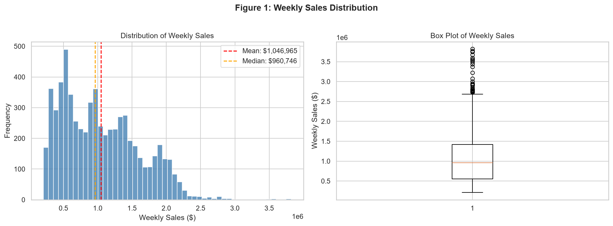
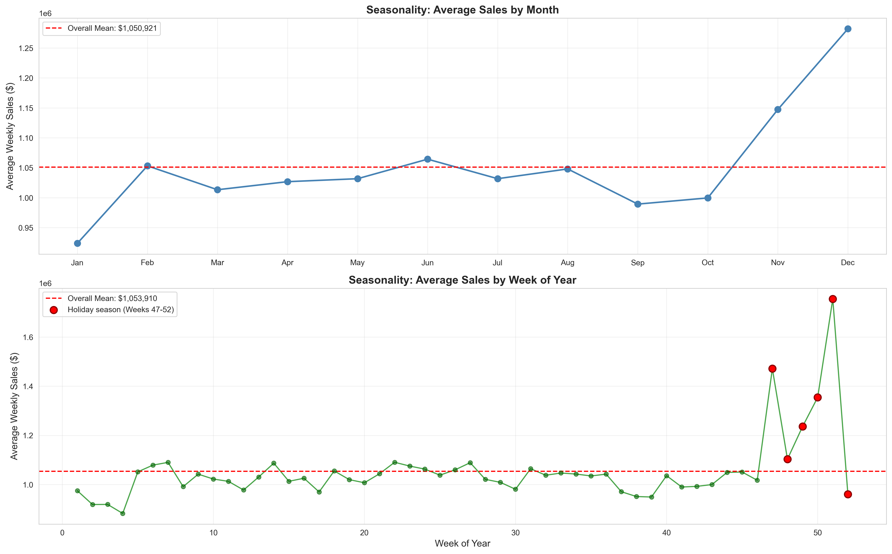
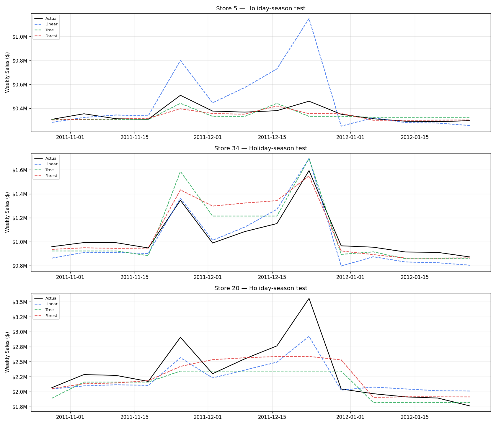

# WalmartCast — Slide Outline

**B.Tech AIML Lab Project — CCE3131**

---

## Slide 1: Title
- Title: WalmartCast — AI-Based Demand Forecasting for Walmart Weekly Sales
- Subtitle: B.Tech AIML Lab Project (CCE3131)
- Name, roll number placeholder
- Date placeholder

## Slide 2: Problem Statement + Dataset Facts
- Problem: predict weekly store sales for 45 Walmart stores
- Supervised regression — target is Weekly_Sales
- Dataset: Kaggle, 6,435 records, 45 stores × 143 weeks, 2010–2012
- 8 columns: Store, Date, Weekly_Sales, Holiday_Flag, Temperature, Fuel_Price, CPI, Unemployment
- Challenge: sales vary 8× between stores; holiday weeks spike unpredictably

## Slide 3: Workflow
- Diagram (text): Raw CSV → Clean & EDA → Feature Engineering → Train 3 Models → Evaluate → Streamlit App
- Each stage: 1 bullet of what was done
  - Clean: verified 6,435 rows, no missing values, retained holiday outliers
  - EDA: 7 figures, correlation heatmap, seasonality plots
  - Features: Year, Month, WeekOfYear, Quarter extracted; one-hot Store/WeekOfYear
  - Models: Baseline + Linear Regression + Decision Tree + Random Forest
  - Evaluate: Standard test + Holiday-season test + Random split
  - App: Streamlit, 3 pages

## Slide 4: EDA Highlights
- 
- Key findings:
  - Store identity is the strongest predictor (correlation -0.335 with store number)
  - Clear November-December seasonality peak
  - Holiday weeks average 7.8% higher sales
  - Economic variables (Temperature, Fuel, CPI, Unemployment) show very weak correlation
- 

## Slide 5: Models Compared
- Table: 3 models + baseline, describe each in one line
  - Baseline: predicts each store's mean weekly sales from training data
  - Linear Regression: weighted sum of features; Store + WeekOfYear one-hot encoded; StandardScaler
  - Decision Tree: if/else rules; Store one-hot; max_depth=None, min_samples_leaf=3
  - Random Forest: 300 trees averaged; Store one-hot; n_estimators=300, min_samples_leaf=2
- Two time-based evaluations:
  - Standard test: train < 2012-04-13, test on remaining weeks (no holidays)
  - Holiday-season test: train < 2011-10-28, test window covers Thanksgiving + Christmas
- Why two tests: the standard test has no holiday weeks — a model ignoring holidays can look great there
- Random 80/20 split included as a secondary comparison only

## Slide 6: Results Table
- Show full results table:

| Model | Standard R² | Standard RMSE | Holiday-season R² | Holiday-season RMSE |
|---|---|---|---|---|
| Baseline | 0.9634 | $102,108 | 0.7865 | $303,261 |
| Linear Regression | 0.9658 | $98,689 | 0.9175 | $188,502 |
| Decision Tree | 0.9570 | $110,602 | 0.8844 | $223,154 |
| Random Forest | 0.9692 | $93,617 | 0.9116 | $195,151 |

- Best model: Linear Regression (lowest mean RMSE across both time-based tests: $143,596)
- All models beat baseline by large margin
- Holiday-season test is substantially harder (RMSE nearly doubles)

## Slide 7: Holiday-Season Test
- Why this matters: the standard test window (Apr–Oct 2012) contains no Thanksgiving or Christmas weeks
- A model blind to holiday patterns can score R²=0.97 on standard, but fail on the harder test
- 
- Key observation: week 51 (pre-Christmas, NOT flagged as holiday) is the biggest spike — and the hardest to predict
- All models still beat the baseline on this test; Linear Regression wins with R²=0.9175 and RMSE=$188,502

## Slide 8: Streamlit App Demo
- 3 pages: Home | Predict | Model Results
- Home: KPI cards, sales-over-time chart, how it works
- Predict: pick store + week → prefilled inputs → predicted sales with delta vs average + historical chart
- Model Results: leaderboard, model comparison charts, feature importance, lessons
- Run: `streamlit run app/app.py` from project root
- Screenshot placeholder: [Insert screenshot of Predict page]

## Slide 9: Limitations and Future Work
- Limitations:
  - Weekly store-level only — no product-level, no daily data
  - Training data 2010–2012 only (2 holiday seasons)
  - Economic variables add little individual predictive power
  - No formal hyperparameter tuning
  - No lag features
- Future work:
  - Hyperparameter tuning with TimeSeriesSplit
  - Lag features (last week's sales, last year's same week)
  - Gradient boosting (XGBoost, LightGBM)
  - More recent or daily-granularity dataset
  - Cloud deployment

## Slide 10: Questions
- Summary:
  - Trained 3 models on Walmart weekly sales data (2010–2012)
  - Best model: Linear Regression — Standard R²=0.9658, Holiday-season R²=0.9175
  - Holiday-season test reveals challenges the standard test hides
  - Working Streamlit app for interactive predictions
- Thank you
- Questions?
